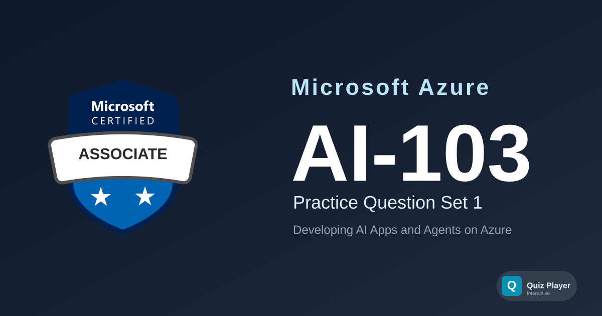

# AI-103 Practice Section 1

Practice questions for the **Azure AI Apps and Agents Developer (AI-103)** certification exam — a beta exam succeeding AI-102. This set covers planning and managing Azure AI Foundry solutions (model/agent deployment, monitoring, security, responsible AI); implementing generative AI and agentic solutions (RAG, tool-calling, multi-agent orchestration, evaluation); computer vision (image/video generation and editing, multimodal understanding); text analysis (language, sentiment, speech, translation); and information extraction (retrieval/grounding pipelines, document intelligence with Content Understanding).

## Content Overview

- **36 Questions** — 12 case-study questions across 4 fictional scenarios plus 24 standalone questions. Single choice, multiple choice, ordering, and matching.
- **Topics**:
  - Plan and manage an Azure AI solution (25–30%)
  - Implement generative AI and agentic solutions (30–35%)
  - Implement computer vision solutions (10–15%)
  - Implement text analysis solutions (10–15%)
  - Implement information extraction solutions (10–15%)

## What This Does Not Cover

This question set focuses on **developer-level Foundry SDK usage, service selection, and agent/RAG design decisions**. It does not include live coding labs, full portal walkthroughs, or infrastructure-as-code authoring exercises. It is not a substitute for official Microsoft Learn training paths, and it is not exam-dump content.

## Disclaimer

> [!IMPORTANT]
> These questions are **AI-generated** for study and practice purposes. They are **not** exam dumps and do not contain actual questions from the Microsoft certification exam. Use them to test your understanding of Azure AI concepts, not as a substitute for official study materials.

## Usage

This repository is designed to be used with the [Quiz Player](https://quizplay.io). Click the badge above to launch the quiz directly.

## License

This content is licensed under the [GNU Affero General Public License v3.0](LICENSE).
