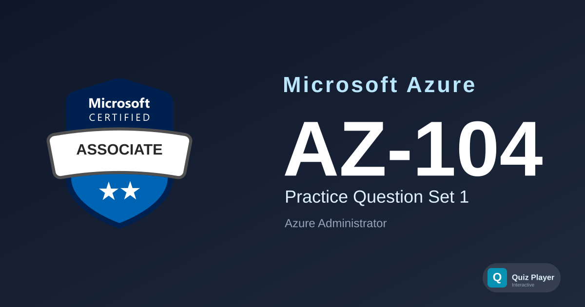

# AZ-104 Practice Section 1

Practice questions for the **Microsoft Azure Administrator (AZ-104)** certification exam. This set tests your understanding of managing Azure identities, governance, storage, compute, and networking — the five core skill areas of the exam.

## Content Overview

- **36 Questions** — Single choice, multiple choice, and ordering
- **Topics**:
  - Manage Azure Identities & Governance (10 questions)
  - Implement & Manage Storage (7 questions)
  - Deploy & Manage Azure Compute Resources (8 questions)
  - Implement & Manage Virtual Networking (7 questions)
  - Monitor & Maintain Azure Resources (4 questions)

## What This Does Not Cover

This question set focuses on **scenario-based conceptual understanding**. It does not cover hands-on lab exercises, CLI/PowerShell command syntax drills, or pricing calculator questions. It is not a substitute for official Microsoft Learn training paths.

## Disclaimer

> [!IMPORTANT]
> These questions are **AI-generated** for study and practice purposes. They are **not** exam dumps and do not contain actual questions from the Microsoft certification exam. Use them to test your understanding of Azure concepts, not as a substitute for official study materials.

## Usage

This repository is designed to be used with the [Quiz Player](https://quizplay.io). Click the badge above to launch the quiz directly.

## License

This content is licensed under the [GNU Affero General Public License v3.0](LICENSE).
