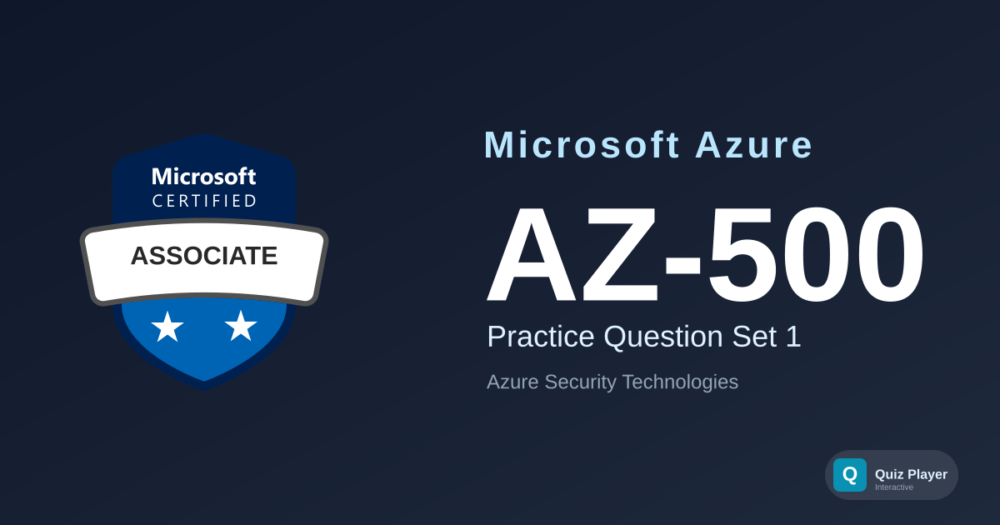

# AZ-500 Practice Section 1

> [!IMPORTANT]
> **Exam retirement notice:** Microsoft retires the AZ-500 exam on **August 31, 2026**. Its successor is **SC-500: Implementing End-to-End Security Controls for Cloud and AI Workloads** — practice for it with [quiz-player-quizzes-sc-500-question-set-1](https://github.com/quizplay-io/quiz-player-quizzes-sc-500-question-set-1) ([play it](https://quizplay.io/quiz.html?source=quizplay-io/quiz-player-quizzes-sc-500-question-set-1)). This AZ-500 set remains useful for candidates testing before the retirement date.

Practice questions for the **Microsoft Azure Security Technologies (AZ-500)** certification exam. This set covers managing identity and access controls, implementing platform protection with firewalls and network security, managing security operations with Microsoft Sentinel, and securing data and applications using Key Vault, encryption, and Defender for Cloud.

## Content Overview

- **36 Questions** — Single choice, multiple choice, and ordering
- **Topics**:
  - Manage Identity and Access (25–30%)
  - Implement Platform Protection (20–25%)
  - Manage Security Operations (25–30%)
  - Secure Data and Applications (20–25%)

## What This Does Not Cover

This question set focuses on **security architecture and configuration decisions**. It does not cover penetration testing techniques, detailed KQL query writing, or step-by-step firewall rule configuration walkthroughs. It is not a substitute for official Microsoft Learn training paths.

## Disclaimer

> [!IMPORTANT]
> These questions are **AI-generated** for study and practice purposes. They are **not** exam dumps and do not contain actual questions from the Microsoft certification exam. Use them to test your understanding of Azure concepts, not as a substitute for official study materials.

## Usage

This repository is designed to be used with the [Quiz Player](https://quizplay.io). Click the badge above to launch the quiz directly.

## License

This content is licensed under the [GNU Affero General Public License v3.0](LICENSE).
