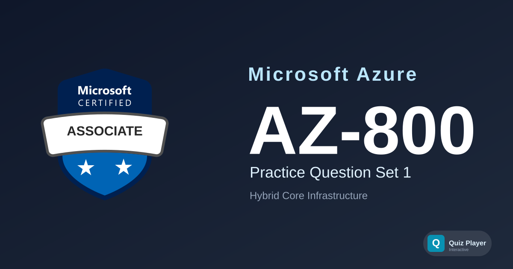

# AZ-800 Practice Section 1

> [!IMPORTANT]
> **Exam retirement notice:** Microsoft retires the AZ-800 (and AZ-801) exams on **September 30, 2026**. The Windows Server Hybrid Administrator Associate certification continues — after that date it is earned by passing the new consolidated **AZ-802** exam. This AZ-800 set remains useful for candidates testing before the retirement date.

Practice questions for the **Administering Windows Server Hybrid Core Infrastructure (AZ-800)** certification exam. This set covers deploying and managing Active Directory in hybrid environments, managing Windows Servers with Azure Arc and Windows Admin Center, working with VMs and containers, configuring hybrid networking with VPNs and ExpressRoute, and managing storage and file services including Azure File Sync.

## Content Overview

- **36 Questions** — Single choice, multiple choice, and ordering
- **Topics**:
  - Deploy and Manage AD DS in On-Premises and Cloud Environments (30–35%)
  - Manage Windows Servers and Workloads in a Hybrid Environment (10–15%)
  - Manage Virtual Machines and Containers (15–20%)
  - Implement and Manage On-Premises and Hybrid Networking (15–20%)
  - Manage Storage and File Services (15–20%)

## What This Does Not Cover

This question set focuses on **hybrid infrastructure management decisions**. It does not cover detailed PowerShell scripting, step-by-step Group Policy configuration, or Windows Server installation walkthroughs. It is not a substitute for official Microsoft Learn training paths.

## Disclaimer

> [!IMPORTANT]
> These questions are **AI-generated** for study and practice purposes. They are **not** exam dumps and do not contain actual questions from the Microsoft certification exam. Use them to test your understanding of Azure concepts, not as a substitute for official study materials.

## Usage

This repository is designed to be used with the [Quiz Player](https://quizplay.io). Click the badge above to launch the quiz directly.

## License

This content is licensed under the [GNU Affero General Public License v3.0](LICENSE).
