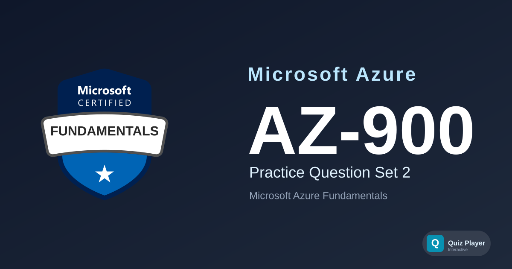

# AZ-900 Practice Section 2

Second practice question set for the **Microsoft Azure Fundamentals (AZ-900)** certification exam. This set approaches the exam domains from fresh angles — cloud pricing models (reservations, spot, pay-as-you-go), serverless computing, private endpoints, passwordless authentication, infrastructure as code, Microsoft Purview, and Azure Monitor — with four new case-study scenarios spanning logistics, energy, hospitality, and manufacturing.

## Content Overview

- **36 Questions** — 12 case study-linked + 24 standalone; single choice, multiple choice, ordering, and matching
- **Topics**:
  - Describe Cloud Concepts (25–30%)
  - Describe Azure Architecture and Services (35–40%)
  - Describe Azure Management and Governance (30–35%)

## What This Does Not Cover

This question set focuses on **foundational cloud and Azure concepts**. It does not cover hands-on portal navigation, CLI commands, advanced networking, or deep-dive architecture design. It is not a substitute for official Microsoft Learn training paths.

## Disclaimer

> [!IMPORTANT]
> These questions are **AI-generated** for study and practice purposes. They are **not** exam dumps and do not contain actual questions from the Microsoft certification exam. Use them to test your understanding of Azure concepts, not as a substitute for official study materials.

## Usage

This repository is designed to be used with the [Quiz Player](https://quizplay.io). Click the badge above to launch the quiz directly.

## License

This content is licensed under the [GNU Affero General Public License v3.0](LICENSE).
