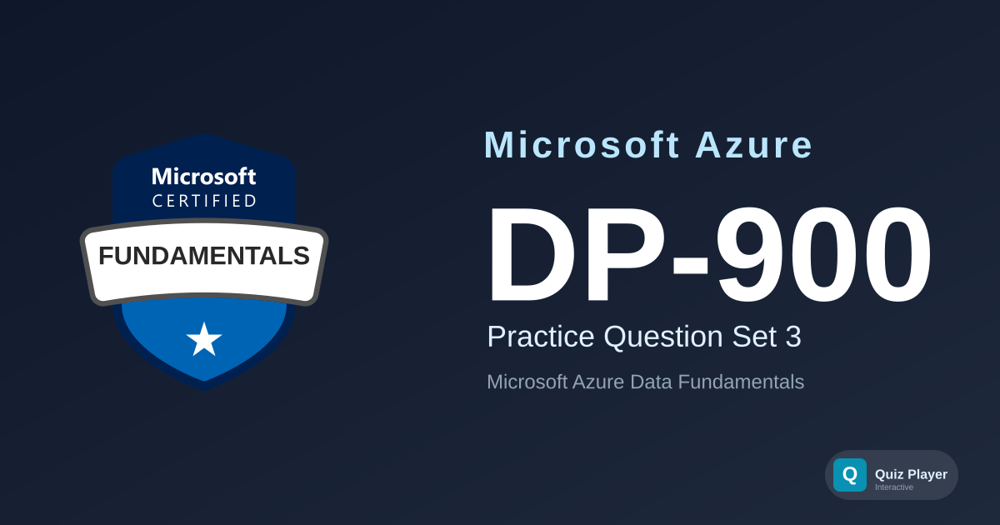

# DP-900 Practice Section 3

Practice questions for the **Microsoft Azure Data Fundamentals (DP-900)** certification exam. This third set covers ACID properties including durability, isolation, and consistency, the transaction lifecycle, batch and stream processing characteristics, Avro serialization and schema-on-read, SQL statements such as UPDATE, ALTER TABLE, DROP TABLE, and GROUP BY, CHECK constraints and database schemas, Azure SQL Database elastic pools, Azure Cosmos DB APIs for Apache Cassandra, Table, and PostgreSQL, zone-redundant storage and storage accounts, NoSQL database types, and analytics workloads with Microsoft Fabric KQL databases, OneLake shortcuts, Direct Lake semantic models, Dataflow Gen2, the medallion architecture on Azure Databricks, star-schema dimension tables, analytics categories, Azure IoT Hub, and Power BI matrix and slicer visuals.

## Content Overview

- **36 Questions** — 12 case-study questions across 4 fictional scenarios plus 24 standalone questions, using single choice, multiple choice, ordering, and matching formats
- **Topics**:
  - Describe core data concepts (25–30%)
  - Identify considerations for relational data on Azure (20–25%)
  - Describe considerations for working with non-relational data on Azure (15–20%)
  - Describe an analytics workload on Azure (25–30%)

## What This Does Not Cover

This question set focuses on **foundational data concepts and Azure data services**. It does not cover hands-on portal navigation, T-SQL programming beyond basic statement categories, database administration procedures, or deep-dive data engineering design. It is not a substitute for official Microsoft Learn training paths.

## Disclaimer

> [!IMPORTANT]
> These questions are **AI-generated** for study and practice purposes. They are **not** exam dumps and do not contain actual questions from the Microsoft certification exam. Use them to test your understanding of Azure data concepts, not as a substitute for official study materials.

## Usage

This repository is designed to be used with the [Quiz Player](https://quizplay.io). Click the badge above to launch the quiz directly.

## License

This content is licensed under the [GNU Affero General Public License v3.0](LICENSE).
