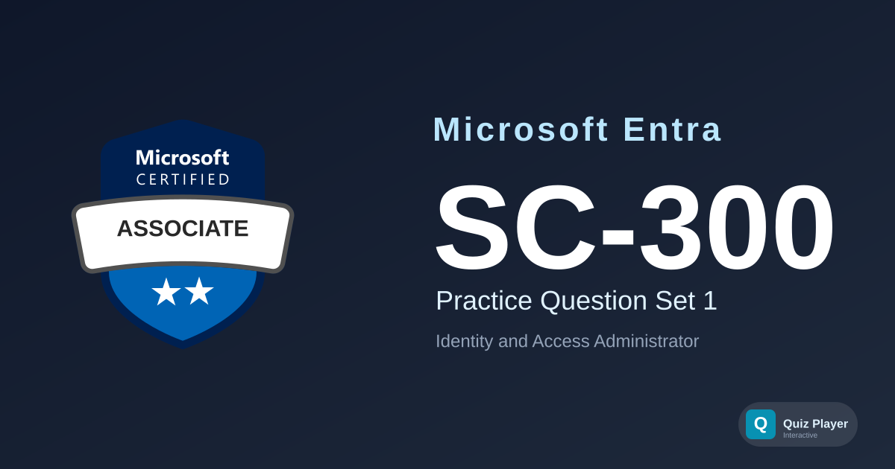

# SC-300 Practice Section 1

Practice questions for the **Microsoft Identity and Access Administrator (SC-300)** certification exam. This set tests deep, scenario-based understanding of designing and operating Microsoft Entra ID — identities, authentication, workload identities, and identity governance — beyond the fundamentals level.

## Content Overview

- **36 Questions** — Single choice, multiple choice, ordering, and matching, including 4 scenario-based case studies (3 questions each)
- **Topics**:
  - Implement and Manage User Identities (8 questions)
  - Implement Authentication and Access Management (10 questions)
  - Plan and Implement Workload Identities (9 questions)
  - Plan and Automate Identity Governance (9 questions)

## What This Does Not Cover

This question set focuses on **scenario-based conceptual and configuration-sequence understanding** at an associate depth — Conditional Access policy design, licensing tier distinctions, hybrid identity trust models, and governance workflows. It does not cover hands-on lab exercises, Microsoft Graph API/PowerShell syntax drills, or Microsoft Entra fundamentals-level (SC-900) "describe" questions. It is not a substitute for official Microsoft Learn training paths.

## Disclaimer

> [!IMPORTANT]
> These questions are **AI-generated** for study and practice purposes. They are **not** exam dumps and do not contain actual questions from the Microsoft certification exam. Use them to test your understanding of Microsoft Entra ID identity and access administration concepts, not as a substitute for official study materials.

## Usage

This repository is designed to be used with the [Quiz Player](https://quizplay.io). Click the badge above to launch the quiz directly.

## License

This content is licensed under the [GNU Affero General Public License v3.0](LICENSE).
