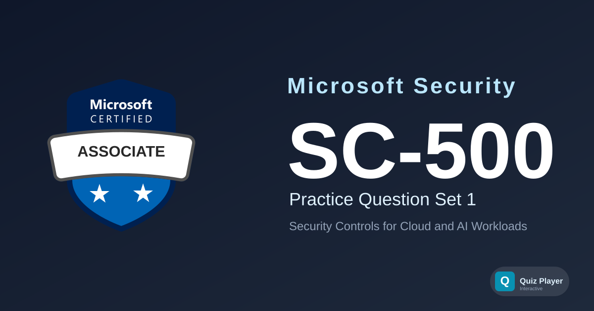

# SC-500 Practice Section 1

Practice questions for the **Implementing End-to-End Security Controls for Cloud and AI Workloads (SC-500)** certification exam — the successor to AZ-500. This set covers Microsoft Entra ID and governance (PIM, Conditional Access, Key Vault, Azure Policy), securing storage, databases, and networking (storage firewalls, Defender for Storage, private endpoints, Azure Firewall), securing compute and AI workloads (Defender for Servers, containers, Entra Agent ID, AI Gateway, Microsoft Foundry guardrails), and managing security posture with Defender for Cloud, Microsoft Sentinel, and Security Copilot.

## Content Overview

- **36 Questions** — 12 case-study linked + 24 standalone; single choice, multiple choice, ordering, and matching
- **Topics**:
  - Manage Identity, Access, and Governance (20–25%)
  - Secure Storage, Databases, and Networking (25–30%)
  - Secure Compute, including Security for AI (20–25%)
  - Manage and Monitor Security Posture (20–25%)

## What This Does Not Cover

This question set focuses on **security configuration and design decisions** for cloud and AI workloads. It does not cover penetration testing techniques, detailed KQL query authoring, or click-by-click portal walkthroughs. It is not a substitute for official Microsoft Learn training paths.

## Disclaimer

> [!IMPORTANT]
> These questions are **AI-generated** for study and practice purposes. They are **not** exam dumps and do not contain actual questions from the Microsoft certification exam. Use them to test your understanding of Azure and Microsoft security concepts, not as a substitute for official study materials.

## Usage

This repository is designed to be used with the [Quiz Player](https://quizplay.io). Click the badge above to launch the quiz directly.

## License

This content is licensed under the [GNU Affero General Public License v3.0](LICENSE).
