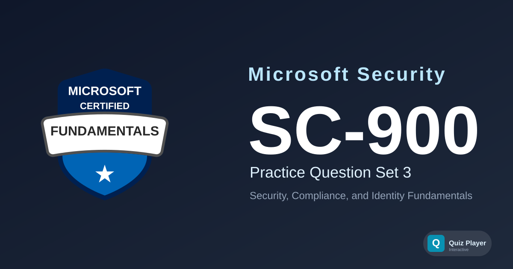

# SC-900 Practice Section 3

Third practice question set for the **Microsoft Security, Compliance, and Identity Fundamentals (SC-900)** certification exam. This set covers the shared responsibility model, Zero Trust principles and pillars, and defense in depth; Microsoft Entra capabilities including External ID, hybrid authentication, device identities, passwordless sign-in with FIDO2, Global Secure Access, and dynamic groups; Microsoft security solutions such as the unified Microsoft Defender portal, automatic attack disruption, Security Exposure Management, Microsoft Secure Score, Defender for Cloud DevOps security, and just-in-time VM access; and Microsoft Purview compliance solutions including trainable classifiers, communication compliance, information barriers, sensitivity and retention labels, eDiscovery tiers, and Microsoft Priva Privacy Risk Management.

## Content Overview

- **36 Questions** — 12 case-study questions across 4 fictional scenarios, plus 24 standalone questions; single choice, multiple choice, ordering, and matching
- **Topics**:
  - Describe the concepts of security, compliance, and identity (10–15%)
  - Describe the capabilities of Microsoft Entra (25–30%)
  - Describe the capabilities of Microsoft security solutions (35–40%)
  - Describe the capabilities of Microsoft compliance solutions (20–25%)

## What This Does Not Cover

This question set focuses on **foundational security, compliance, and identity concepts**. It does not cover hands-on portal configuration, PowerShell or CLI commands, or the deep implementation detail tested in associate-level exams such as SC-300 or AZ-500. It is not a substitute for official Microsoft Learn training paths.

## Disclaimer

> [!IMPORTANT]
> These questions are **AI-generated** for study and practice purposes. They are **not** exam dumps and do not contain actual questions from the Microsoft certification exam. Use them to test your understanding of security, compliance, and identity concepts, not as a substitute for official study materials.

## Usage

This repository is designed to be used with the [Quiz Player](https://quizplay.io). Click the badge above to launch the quiz directly.

## License

This project is licensed under the GNU Affero General Public License v3.0 — see the [LICENSE](LICENSE) file for details.
